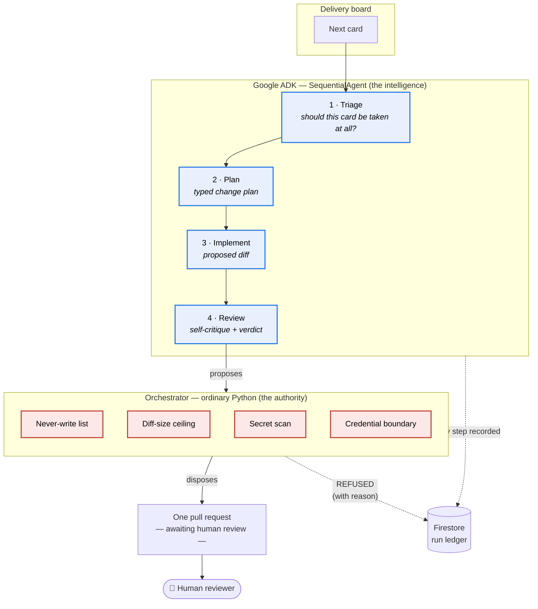

# AutoPilot Agentic

**An agent crew that takes the next ticket off a delivery board, writes the change in your repository, and opens one pull request for review — then stops at a gate it has no way to open.**

🎥 **Demo (2:45):** https://youtu.be/Aq7Dk8crQro
🌐 **Live console:** https://autopilot-agentic-tzmww5pzea-uc.a.run.app
🏢 **Built by:** [OpsAgents AI](https://opsagents.agency)

> **About this repository.** This is the public architecture and documentation repository for AutoPilot Agentic. The running implementation is a private production service; what is described here is its real design, and the demo video is captured from the live system. See [Why the implementation is not public](#why-the-implementation-is-not-public).

---

## The problem

Any capable model can write code. The hard part of letting one near a real repository is **restraint**.

Teams adopting coding agents hit the same wall: the agent is competent and completely unbounded. It will happily take a card it should have refused, grow a change past what any human will actually review, paste a credential into a config file, or — the one that ends the experiment — edit the CI workflow that governs it. Every one of those is a *reasonable* action from the model's point of view. None of them is acceptable.

The usual answer is to make the model more careful: better prompts, more instructions, a bigger context. That fails, because you are asking the thing being governed to enforce its own governance.

## Who this is for

Small engineering teams who want an agent to absorb the routine end of a delivery board — the well-specified cards nobody enjoys — without giving up the review gate that keeps the codebase sane. The ones who cannot afford a human babysitting every run, and cannot afford an unsupervised writer either.

## Why it matters

The value is not the code the agent writes. It is that **a human still sees every change before it lands, and the agent cannot route around that.** Autonomy without a gate is not a productivity gain, it is a liability transfer. This design makes the gate structural rather than advisory: the intelligence and the authority are different systems, and the intelligent one cannot reach the authority.

---

## Architecture

### The load-bearing idea

**The model proposes; the orchestrator disposes.**

The four ADK agents are `LlmAgent`s with typed output schemas, composed into a `SequentialAgent`. They reason, plan and write. They have no ability to commit, no credential, and no path to the guard logic.

The guards are plain Python in a process the agents cannot call. They are not prompts, not instructions, and not negotiable. A refusal is final and is written to the run ledger with its reason, so a human can see *what the crew wanted to do and why it was stopped* — which is the interesting half of the log.

### The moment that shows the design working

In the second run of the demo video, the crew is asked to improve CI. It produces a perfectly reasonable GitHub Actions workflow. **The reviewer agent approves it.** The never-write list refuses it anyway — because a runner that can edit its own CI can grant itself anything.

That is the whole thesis in one frame: the smartest component in the system was wrong, and it did not matter, because it was never the component holding the pen.

---

## Stack

| Layer | Technology |
|---|---|
| Agent framework | **Google ADK** — `SequentialAgent` over four `LlmAgent`s, each with a typed output schema |
| Model | **Gemini 3.5 Flash** via Vertex AI, global endpoint, resolved by probing a ladder at boot |
| Compute | **Cloud Run** (service + console) |
| State | **Firestore** — append-only run ledger |
| Build & deploy | **Cloud Build** + **Artifact Registry**, keyless via **Workload Identity Federation** |
| Authority layer | Plain Python — deliberately not an agent, deliberately not reachable from one |

---

## Guard inventory

| Guard | Refuses | Why it exists |
|---|---|---|
| **Never-write list** | Changes to CI config, deploy workflows, IAM, the guard logic itself | An agent that can edit its own governance has none |
| **Diff-size ceiling** | Changes past what a human will genuinely read | An unreviewed approval is worse than no review |
| **Secret scan** | Any diff carrying credential-shaped content | Irreversible once pushed |
| **Credential boundary** | Any agent-initiated write | The crew holds no token; only the orchestrator can push |
| **Card triage** | Cards too vague, too large, or out of scope | Refusing work is a feature, not a failure |

Every refusal is recorded with its reason. A run that refuses everything and opens no PR is a **successful** run.

---

## Why the implementation is not public

AutoPilot Agentic runs against live client repositories and delivery boards. Its prompt set, guard heuristics and tenant configuration are the product, and publishing them would both expose client material and hand anyone the exact map of what the guards do and do not catch — which is precisely the information you would want in order to get a change past them.

This repository therefore carries the **design, the architecture and the reasoning**, which is what the work is actually about. The demo video is captured from the live system rather than a mockup, and the live console is open to judges at the link above.

---

## License

[Apache-2.0](LICENSE).
